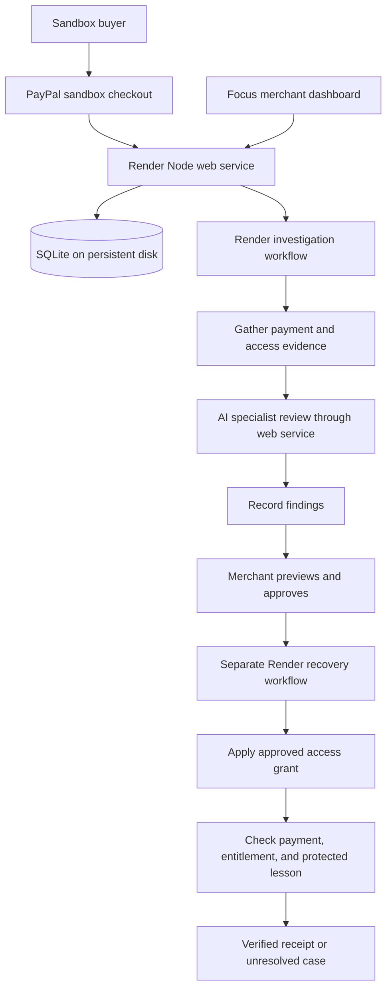

# PayTrace Recover: PayPal Sandbox and Render Build Guide

This runbook takes the existing application from a local demonstration to a deployed, verifiable PayPal sandbox recovery flow. Follow the stages in order and complete each checkpoint before continuing.

**Integration status:** adapters and tests exist, but live PayPal, AI, and Render execution has not yet been validated. This document describes the build and acceptance process, not completed deployment evidence. The public Sites demo remains a browser simulation.

## Contents

1. [Target outcome and architecture](#target-outcome-and-architecture)
2. [Prerequisites](#prerequisites)
3. [Local baseline](#1-local-baseline)
4. [PayPal sandbox](#2-paypal-sandbox)
5. [Actual AI review](#3-actual-ai-review)
6. [Render web service](#4-render-web-service)
7. [Render Workflows](#5-render-workflows)
8. [Focus dashboard handoff](#6-focus-dashboard-handoff)
9. [Acceptance testing](#7-acceptance-testing)
10. [Troubleshooting](#troubleshooting)
11. [Release and pilot readiness](#release-and-pilot-readiness)

## Target outcome and architecture

A fictional learner buys a $128 course through PayPal sandbox. The application deliberately leaves course access locked. PayTrace gathers payment and access evidence, asks AI specialists to review a minimal correction, requests merchant approval, applies one access grant, and independently checks that the protected lesson can be retrieved.

The injected access failure belongs to our demo course service. It is not a diagnosed PayPal failure or an external LMS outage.



The web service owns credentials, authorization, state, and provider calls. Workflow tasks call authenticated web-service endpoints. AI interprets supplied evidence; deterministic application rules control whether a write is allowed. The frontend and API use the same origin.

## Prerequisites

- [Repository](https://github.com/sagitta414/paytrace-recover) and Git access.
- Node.js 24 or newer and npm.
- PayPal Developer access, a sandbox REST app, a sandbox business seller, and a separate personal buyer.
- An AI API key and an explicitly selected model compatible with the existing structured-output adapter.
- A Render account connected to the repository, with access to Web Services and Workflows.
- Budget for Render hosting/persistent storage, workflow execution, and model calls. PayPal purchases here use sandbox funds.

Keep credentials in the ignored local `.env` or Render environment settings. Never commit them or include them in screenshots, issues, or recordings. The browser receives the PayPal client ID by design; it must never receive the client secret, model key, Render API key, or workflow secret.

## 1. Local baseline

For a fresh checkout in PowerShell:

```powershell
git clone https://github.com/sagitta414/paytrace-recover.git
cd paytrace-recover
node --version
npm ci
npm test
Copy-Item .env.example .env
npm start
```

If using an existing checkout, skip cloning. Copy `.env.example` only when `.env` does not already exist; do not overwrite configured values.

| URL | Purpose |
| --- | --- |
| `http://127.0.0.1:4358/recover.html` | Developer unlock, learner checkout, and recovery desk |
| `http://127.0.0.1:4358/focus.html` | Focus merchant dashboard |
| `http://127.0.0.1:4358/health` | Basic server liveness |

Use the explicit `.html` paths with the Node server. The static Sites host and Node server have different routing behavior.

Run a sample case through investigation, rehearsal, approval, correction, and verification. The last verified baseline contained 55 passing tests; use the result of your current checkout as the authoritative count.

**Checkpoint:** tests pass, the learner begins locked, approval is required, and a verified repair grants access once. No external credentials are needed for this baseline.

## 2. PayPal sandbox

### Create the accounts and app

1. Open the [PayPal Developer Dashboard](https://developer.paypal.com/dashboard/).
2. Select the Sandbox environment and create a REST app named `PayTrace Recover Sandbox`.
3. Use the sandbox business account associated with that application as the seller.
4. Copy the sandbox client ID and client secret into your private configuration.
5. Locate or create a separate sandbox personal account and obtain its buyer login credentials.

Use the buyer account at checkout. Do not use the seller account to buy from itself. See [PayPal REST setup](https://developer.paypal.com/api/get-started/) and [sandbox accounts](https://developer.paypal.com/sandbox-testing/accounts).

### Configure locally

```dotenv
PORT=4358
PUBLIC_URL=http://127.0.0.1:4358
DATABASE_PATH=./data/courselatch.sqlite
PAYPAL_CLIENT_ID=YOUR_SANDBOX_CLIENT_ID
PAYPAL_CLIENT_SECRET=YOUR_SANDBOX_CLIENT_SECRET
DEMO_OPERATOR_KEY=YOUR_PRIVATE_RANDOM_OPERATOR_KEY
```

Generate the operator key locally and store the output privately:

```powershell
node -e "console.log(require('node:crypto').randomBytes(32).toString('hex'))"
```

The operator key unlocks configured integrations for one demo session. It is not production merchant authentication. `server/paypal.mjs` hardcodes the sandbox API host; do not supply live credentials.

### Make a test purchase

1. Restart the Node server after changing `.env`.
2. Open `/recover.html` and expand **Developer setup: unlock configured integrations**.
3. Enter the operator key and unlock the session.
4. Choose **Restart story**, then switch to the learner storefront.
5. Select the actual PayPal button, not the sample-payment control.
6. Sign in with the sandbox personal buyer and approve the $128 USD purchase.
7. Confirm that payment is captured while the demo course remains locked.
8. Investigate, rehearse, approve, apply the correction, and verify access.
9. Open the protected lesson and check the seller's sandbox transaction record.

| Evidence | Required result |
| --- | --- |
| Order and capture | Real sandbox identifiers recorded |
| Payment status | `COMPLETED` |
| Ownership | Order reference matches this internal purchase |
| Amount/currency | $128.00 USD |
| Initial entitlement | Locked despite completed payment |
| Recovery | One access write after approval |
| Verification | Fresh payment, entitlement, and content checks pass |
| Payment side effects | No additional capture, charge, or refund from recovery |

**Checkpoint:** save redacted order/capture identifiers and a successful verification receipt. Only sandbox checkout uses PayPal here; seeded portfolio cases remain fictional.

## 3. Actual AI review

Add the following values to the web application's environment:

```dotenv
OPENAI_API_KEY=YOUR_PRIVATE_API_KEY
OPENAI_MODEL=YOUR_AVAILABLE_STRUCTURED_OUTPUT_MODEL
```

No model is silently selected. The existing adapter performs six bounded calls: specialist findings, Prism objections, one response round, and a final resolution of objections. Read [integration setup](SETUP.md#3-ai-review) and `server/ai.mjs` before changing this contract.

Restart, unlock the operator session, and investigate a fresh case. Verify that the recovery desk identifies model-generated review. Inspect the actual claims against source records; valid citation IDs do not prove that a claim is correct.

- Ledger examines payment evidence.
- Relay examines access and delivery evidence.
- Patch proposes a minimal correction.
- Prism challenges the recommendation and unresolved assumptions.

**Checkpoint:** the real model provides useful findings and traceable sources, preserves uncertainty, and cannot override eligibility or merchant approval. Invalid output or a provider failure must stop progress instead of silently substituting scripted approval.

## 4. Render web service

Deploy the local path first without Workflows so hosting issues remain separate from orchestration issues.

Create a **Web Service** linked to this repository, or use the existing root `render.yaml` Blueprint. Do not create both and accidentally provision duplicate services.

| Setting | Value |
| --- | --- |
| Branch | `main` |
| Root directory | Repository root; leave blank |
| Runtime | Node |
| Build command | `npm ci` |
| Start command | `npm start` |
| Health check | `/health` |
| Node version | `24` |
| Instances | One |
| Persistent disk | 1 GB, mounted at `/var/data` |
| Database path | `/var/data/courselatch.sqlite` |

The Blueprint currently calls the service `courselatch`; that is an internal legacy name. Use the hostname Render actually assigns. It specifies a paid Starter instance. Confirm current costs before creating resources. Render requires paid services for persistent disks; data outside the mounted directory is ephemeral. See [persistent disks](https://render.com/docs/disks) and [Blueprint configuration](https://render.com/docs/blueprint-spec).

### Web-service environment

| Variable | Value or purpose |
| --- | --- |
| `NODE_VERSION` | `24` |
| `PUBLIC_URL` | Exact assigned HTTPS origin, without a page path |
| `DATABASE_PATH` | `/var/data/courselatch.sqlite` |
| `PAYPAL_CLIENT_ID` | Sandbox client ID |
| `PAYPAL_CLIENT_SECRET` | Sandbox client secret |
| `DEMO_OPERATOR_KEY` | Private operator key; Blueprint can generate it |
| `OPENAI_API_KEY` | Private model provider key |
| `OPENAI_MODEL` | Explicit compatible model identifier |

Let Render supply the server port. Do not copy local `PORT=4358` unnecessarily. If the service URL is not known until creation, update `PUBLIC_URL` to the assigned origin and redeploy before testing mutations.

Open `/health`, `/recover.html`, and `/focus.html` on the Render hostname. Repeat the sandbox purchase and AI review there. A successful health response proves only server liveness, not provider connectivity.

**Checkpoint:** HTTPS checkout and recovery work, and a completed case survives a service restart in the same browser session. The current SQLite storage and in-process locks require one web-service instance.

## 5. Render Workflows

The repository's existing Blueprint provisions only the web service. For this runbook, create the workflow separately in Render's Dashboard using **New > Workflow**. See [Your First Workflow](https://render.com/docs/workflows-tutorial).

| Setting | Value |
| --- | --- |
| Repository/branch | This repository, `main` |
| Root directory | Repository root; leave blank |
| Runtime | Node |
| Build command | `npm ci` |
| Start command | `npm run workflows` |
| Region | Prefer the web service's region |

Do not set the root to `workflows/`: this project's package manifest and lockfile are at the repository root.

### Workflow-service environment

```dotenv
NODE_VERSION=24
APP_URL=https://YOUR-SERVICE.onrender.com
WORKFLOW_SECRET=YOUR_PRIVATE_SHARED_WORKFLOW_SECRET
```

Generate a new random secret using the local command above. Do not reuse the operator key. `APP_URL` points to the web service, not the static Sites demo. The current tasks call the web service, so PayPal and AI keys stay on the web service rather than being duplicated into the workflow service.

Confirm all seven tasks appear after deployment:

```text
gatherEvidence
consultSpecialists
recordFindings
applyApprovedRepair
verifyLearnerAccess
investigate
recover
```

### Connect the web service to registered tasks

Create a Render API key in your account settings and add these values to the **web service**:

```dotenv
WORKFLOW_SECRET=SAME_SECRET_AS_THE_WORKFLOW_SERVICE
RENDER_API_KEY=YOUR_PRIVATE_RENDER_API_KEY
RENDER_INVESTIGATE_TASK=ACTUAL_WORKFLOW_SLUG/investigate
RENDER_RECOVER_TASK=ACTUAL_WORKFLOW_SLUG/recover
```

Copy the actual task identifiers from Render. Do not paste task page URLs or assume the display name is the slug. See [triggering task runs](https://render.com/docs/workflows-running).

Redeploy the web service and start investigation through the application in an unlocked operator session. Do not manually invoke recovery tasks with fabricated session/job identifiers: the application creates and validates those identifiers.

Expected sequence:

1. `investigate` calls `gatherEvidence`, `consultSpecialists`, then `recordFindings`.
2. Investigation completes without granting access.
3. The merchant reviews a rehearsal and explicitly approves it.
4. The merchant starts the correction.
5. `recover` calls `applyApprovedRepair`, then `verifyLearnerAccess`.
6. Only passing verification closes the case.

**Checkpoint:** retain successful Render run IDs for both root tasks and inspect the child stages. Test retry behavior; task retries alone do not establish exactly-once business effects. The current adapter and mocked tests still require real-service validation.

## 6. Focus dashboard handoff

Use `/recover.html` for operator unlock and sandbox checkout, then open `/focus.html` on the **same Render origin in the same browser session**. A different hostname, browser profile, or private session gets a different workspace. Reopen the paid case from the queue if needed.

Focus already reads payment and access information independently, shows source failures, retains last-known information, and blocks unsafe progression after uncertain requests. Use the explicit refresh action to reconcile current server state. Do not interpret a browser timeout as proof that an operation failed.

Remaining integration UX work:

- Add a direct setup/checkout entry point from Focus.
- Distinguish configured integrations from successfully checked integrations.
- Surface workflow progress and run references clearly.
- Keep model-generated versus scripted labels consistent.
- Make prolonged waiting, status refresh, and unresolved verification obvious.

These items are planned improvements, not claims that additional UI has been implemented by this documentation change.

## 7. Acceptance testing

Run `npm test` before release. Then test the deployed service; automated mocks do not replace real-provider acceptance.

| Scenario | Expected behavior |
| --- | --- |
| Completed sandbox payment, missing access | One approved correction; independent verification passes |
| Pending payment or mismatched purchase | Correction blocked |
| Payment read unavailable | Evidence marked unavailable; no approval based on stale data |
| Access read unavailable | Preserve known values; status unconfirmed; mutation blocked |
| Invalid/unavailable model output | Visible failure; no scripted approval fallback |
| No merchant approval | Zero repair writes |
| Evidence changes after preview | Approval invalidated; review required again |
| Response lost after successful correction | Read current state; do not blindly repeat the write |
| Verification fails after grant | Case remains unresolved; retry reads without another grant |
| Render retries a stage | No duplicate entitlement or unauthorized transition |
| Browser reload/server restart | Durable case information remains available |
| Different demo sessions | Cases remain isolated |

Use controlled test fixtures or injected faults when a provider failure cannot reliably be reproduced in sandbox. Label each result as a real-provider test or an injected/mock test. Existing automated failure coverage is in `tests/focus-reliability.test.mjs` and the other test files.

### Evidence record template

Record each live acceptance run privately first, then publish only redacted material:

```text
Date/time:
Commit SHA:
Deployment URL:
Test scenario:
Real providers versus injected faults:
Sandbox order/capture references:
Investigation/recovery run references:
Model identifier and review outcome:
Merchant approval observed:
Access write count:
Verification result and lesson check:
Restart persistence result:
Remaining failures:
```

Never include keys, buyer passwords, session cookies, bearer tokens, or unredacted customer information in public evidence.

## Troubleshooting

| Symptom | Check and safe next action |
| --- | --- |
| PayPal button absent | Use `/recover.html`, unlock the operator session, restart the story, select learner view, and confirm no payment exists yet |
| Sandbox authentication fails | Confirm both credentials come from the same sandbox app; restart after edits |
| Buyer checkout fails | Use the separate personal sandbox account; inspect sandbox account/app configuration |
| Mutation rejected on Render | Ensure `PUBLIC_URL` exactly matches the browser origin, including HTTPS |
| UI still says simulation | Open the Render/local Node URL; the Sites deployment serves static runtime configuration |
| Review remains scripted | Confirm AI key/model, restart, unlock this session, and run a new investigation |
| Workflow tasks missing | Check repository root, build/start commands, and task registration logs |
| Render rejects dispatch | Check API key, actual task slugs, and all required workflow environment values |
| Workflow callback fails | Check `APP_URL`, matching `WORKFLOW_SECRET`, and web-service availability |
| Database resets after deploy | Verify the disk mount and `DATABASE_PATH`; only the mounted path persists |
| Request times out | Refresh status safely; inspect the existing run before initiating another mutation |
| Verification stays unresolved | Inspect payment, entitlement, and lesson checks; retry verification, not the grant |
| A job stays pending after interruption | Inspect Render run state and web-service logs; there is no automatic abandoned-job recovery daemon yet |

## Release and pilot readiness

### Hackathon release gate

- [ ] Real sandbox checkout and capture demonstrated.
- [ ] Actual AI review with inspectable evidence demonstrated.
- [ ] Render investigation and approved-recovery runs completed.
- [ ] Merchant approval precedes the only access grant.
- [ ] Protected content independently verified.
- [ ] Failed requests and verification failures handled clearly.
- [ ] Persistence verified after restart.
- [ ] Public source and setup instructions reproduce the demo.
- [ ] Video and screenshots distinguish simulation from integrated execution.
- [ ] README integration-status claims updated only after successful live evidence.

Keep the public static demonstration available as a clearly labeled preview. Publish the real Render URL once its acceptance checks pass. Avoid deploying during a recorded recovery run. Before changing persistence, take a SQLite-consistent backup and test restoration in a separate environment; a code rollback does not undo an access grant or a schema change.

### Before a real merchant pilot

Add merchant authentication, tenant authorization, an actual course-platform connector, verified webhook handling, durable cross-process idempotency, refund/revocation behavior, retention controls, backups, monitoring, and recovery for abandoned jobs. Review the reliability of the entire workflow before enabling more than one web instance.

AG Studio remains optional and unimplemented. Finish the verified PayPal/AI/Render loop before expanding sponsor scope.

## Related documents

- [Main README](../README.md)
- [Integration reference](SETUP.md)
- [Focus frontend and failure handling](FOCUS-FRONTEND.md)
- [Development plan](DEVELOPMENT_PLAN.md)
- [Demo script](DEMO_SCRIPT.md)
- [Render web-service Blueprint](../render.yaml)
- [Environment template](../.env.example)
